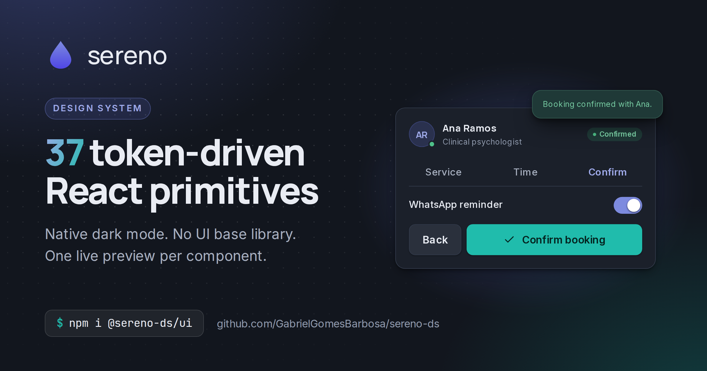

<div align="center">

# Sereno Design System

Token-driven React primitives for the Sereno scheduling platform, native dark mode,
no UI base library, one live preview per component.

[](https://www.npmjs.com/package/@sereno-ds/ui)
[](https://www.npmjs.com/package/@sereno-ds/tokens)
[](https://github.com/GabrielGomesBarbosa/sereno-ds/actions/workflows/ci.yml)
[](./LICENSE)


**[Design System ↗](https://docs-production-2f40.up.railway.app)** &nbsp;·&nbsp;
**[Live demo ↗](https://demo-production-bfd0.up.railway.app)** &nbsp;·&nbsp;
[Workspaces](#workspaces) &nbsp;·&nbsp;
[Components](#components) &nbsp;·&nbsp;
[Getting started](#getting-started) &nbsp;·&nbsp;
[Testing](#testing) &nbsp;·&nbsp;
[Contributing](#contributing)

[](https://docs-production-2f40.up.railway.app)

</div>

---

The visual / front-end layer of **Sereno**, a scheduling platform for independent
health & beauty professionals in Brazil: the Design System, a navigable showcase,
and four real product screens on mocked data, no backend, everything static.

## Workspaces

npm workspaces + Turborepo.

| Path | Name | What |
|---|---|---|
| `packages/tokens` | [`@sereno-ds/tokens`](https://www.npmjs.com/package/@sereno-ds/tokens) | the token layer: `*.css` (light × dark) + a `tokens.css` barrel |
| `packages/ui` | [`@sereno-ds/ui`](https://www.npmjs.com/package/@sereno-ds/ui) | **37 React primitives** + `src/styles.css` + `_internal/` + `theme/` (`ThemeProvider` / `ThemeToggle`), token-driven inline styles, native dark mode, no Radix / MUI / Tailwind |
| `apps/docs` | [`docs`](https://docs-production-2f40.up.railway.app) | the `/design-system` showcase (Next 16, `output: 'export'`). MUI-doc-style page per component: live preview, "show code", Do / Don't, "on this page" rail, prev/next, versioned header |
| `apps/demo` | [`demo`](https://demo-production-bfd0.up.railway.app) | `/` hub + `/agendar/[slug]` (public booking) + `/dashboard/[[...slug]]` + `/onboarding` + `/kiosk` (waiting-room call panel) + `src/screens/` + `src/lib/mock.ts`, fully responsive, components reflow |

- **`@sereno-ds/ui` and `@sereno-ds/tokens` are real packages.** `@sereno-ds/ui` is compiled
  with `tsup` into `packages/ui/dist` (one file per module, each keeps its own `'use client'`,
  types included) and the apps use that build through the workspace link, exactly as an
  outside consumer would; Turborepo builds the packages before the apps. `@sereno-ds/tokens` is
  plain CSS.
- The component stylesheet (`@keyframes`, `:checked` / `:focus-visible`,
  `::-webkit-scrollbar`, one responsive reflow, and the hover / press / focus states of
  `Button`, `IconButton` and `Card`) is
  **`packages/ui/src/styles.css`**: required, load it once at the app root (those three render unstyled without it). Each app's
  `globals.css` does `@import "@sereno-ds/tokens/tokens.css"` then
  `@import "@sereno-ds/ui/styles.css"`, then only its own shell rules.
- Icons: `lucide-react` passed to components as props (a `peerDependency`).
- Fonts: `next/font/local` per app, reading the files in `fonts/` (no download at build time); the `--font-*` CSS vars are the `@sereno-ds/ui`
  contract.

## Getting started

Needs React 18 or 19 (`react`, `react-dom`) and `lucide-react` (icons are passed to components as props).

```bash
npm install @sereno-ds/ui @sereno-ds/tokens lucide-react
```

```tsx
import '@sereno-ds/tokens/tokens.css';
import '@sereno-ds/ui/styles.css';
import { Button, Card, ThemeProvider } from '@sereno-ds/ui';

export default function App() {
  return (
    <ThemeProvider>
      <Card padding="lg">
        <Button variant="accent">Confirm booking</Button>
      </Card>
    </ThemeProvider>
  );
}
```

The two stylesheet imports go **once, at the app root, tokens first**. The three font
variables (`--font-inter`, `--font-manrope`, `--font-jetbrains-mono`) are yours to provide
(system fallbacks are built in): the full setup, with the `next/font` snippet, is in
[`packages/ui/README.md`](./packages/ui/README.md#setup---three-things-once-at-the-app-root).

Browse every primitive (props, live preview, code, Do / Don't) on the
**[Design System site](https://docs-production-2f40.up.railway.app)**.

### Developing this monorepo

Needs **Node 20 or newer** (CI runs Node 20) and **npm 10** (`packageManager` pins `npm@10.8.2`).
**Docker** is only needed for the pixel tests (see [Testing](#testing)); nothing else uses it.

```bash
npm install
npm run dev          # docs on :3001, demo on :3002, and @sereno-ds/ui rebuilt on save
```

| Command | What it does |
|---|---|
| `npm run dev` | `turbo run dev`: the docs (`:3001`), the demo (`:3002`) and `tsup --watch` for `@sereno-ds/ui` |
| `npm run build` | `turbo run build`: the packages first, then each app writes its own `out/` |
| `npm run build:docs` / `build:demo` | build one app (and the packages it needs) |
| `npm run serve:docs` / `serve:demo` | serve a built `out/` on `$PORT` (3000 by default), what Railway runs |
| `npm run lint` | ESLint, every workspace (the Compiler-era `react-hooks` rules are errors) |
| `npm run typecheck` | `tsc --noEmit`, every workspace |
| `npm test` | the **behavior tests** (Vitest), every workspace |
| `npm run test:visual` | the **pixel tests**: builds the docs and compares every component with its reference images (Docker) |
| `npm run test:visual:update` | rewrites the reference images; only after a person approved the new pixels |
| `npm run check:dashes` | fails if any tracked file has an em dash (SS-330) |
| `npm run gen:component-docs` | regenerates [`DESIGN_SYSTEM.md`](./DESIGN_SYSTEM.md) from the docs catalog (never edit that file by hand) |
| `npm run gen:brand-images` | regenerates the committed Open Graph image of the demo and the Apple touch images of both apps |
| `npm run gen:banner` | regenerates the banner of this README and the link-share card of the Design System (`apps/docs/app/opengraph-image.png`) from the catalogue and the real components (Docker; run it when a component is added, `npm run check:banner` fails in CI otherwise) |
| `npm run changeset` | records a version note for a change in `packages/` (see [Versioning](#versioning--releases)) |
| `npm run version-packages` / `release` | cut the version bump and changelog / build and publish to npm (CI does both) |

`npm run build` must be green: **docs = 46 routes** (37 component pages + tokens +
overview + robots + a few static assets) and **demo = 49 routes** (hub + 3 `/agendar` slugs + all 36
`/dashboard` nav destinations + onboarding + robots + sitemap), both counts move
as components / nav items are added, treat them as a sanity check, not a fixed
target.

## Testing

Two layers, for two kinds of mistake. The full guide is [`docs/testing.md`](./docs/testing.md).

| | Catches | Tool | Command |
|---|---|---|---|
| **Behavior tests** | a component that *does* the wrong thing (a click, a key, a state, a label, accessibility) | Vitest, Testing Library, user-event, jest-axe, in jsdom | `npm test` |
| **Pixel tests** | a component that *looks* different: one pixel of colour, spacing, border, font or shadow | Playwright in a pinned Docker image | `npm run test:visual` |

**Behavior tests** sit next to each component (`<Component>.test.tsx`), and a smoke test renders every exported
component, drives it and runs an accessibility check (axe) on it: a new component adds its case to
`packages/ui/src/test/components.smoke.test.tsx`.

**Pixel tests** photograph the live demo of **every example of every component** in the docs, in the light theme,
the dark theme and at phone width (375 px), plus the hover, the pressed state, the keyboard focus and what each trigger opens (a list,
a menu, a dialog, a toast), and compare it with the reference image in the repository. **Any pixel that changes
visibly fails the test** (only a rounding difference of a level or two of 255 in a colour is ignored, see the
guide). If the change is on purpose, a person looks at it on screen, approves it, and the references are
updated in the same PR (`npm run test:visual:update`); otherwise it is a regression to fix, never a reference to
refresh.

- They run in **Docker** (`mcr.microsoft.com/playwright`, pinned), locally and in CI, because the same pixels need
  the same fonts, the same Chromium and the same CPU architecture (arm64). Docker must be running; the image is
  about 3.6 GB and is pulled on the first run.
- References: `apps/docs/e2e/__screenshots__/` (`light`, `dark`, `mobile`). Tests: `apps/docs/e2e/visual.spec.ts`.
- When one fails, CI uploads the `visual-differences` artifact (expected, actual and diff images, plus an HTML
  report); locally, open `apps/docs/e2e-report/index.html`.

**Continuous integration** (`.github/workflows/ci.yml`, on every PR and on `main`) runs three jobs: `lint ·
typecheck · test · build` (also the em-dash check), `npm publish --dry-run` for both packages (what would ship), and
`visual regression (pixel by pixel)`. `release.yml` publishes to npm from `main` (see below).

## Components

| Category | Components |
|---|---|
| **core** (13) | `ActionCard` · `Avatar` · `Badge` · `Brand` · `Button` · `Card` · `Divider` · `IconButton` · `Menu` · `StatCard` · `StatusDot` · `Table` · `Typography` |
| **forms** (13) | `Autocomplete` · `AvatarUpload` · `CalendarLegend` · `Checkbox` · `DatePicker` · `DateTimePicker` · `FileUpload` · `Input` · `Radio` · `SearchInput` · `Select` · `Switch` · `Textarea` |
| **navigation** (6) | `BottomNav` · `Pagination` · `SidebarNav` · `Stepper` · `Tabs` · `TopBar` |
| **feedback** (5) | `Alert` · `Dialog` · `EmptyState` · `Skeleton` · `Toast` |
| **theme** (2) | `ThemeProvider` · `ThemeToggle` |

Product-domain cards (`ServiceCard`, `ProfessionalCard`, `AppointmentCard`,
`WeeklyScheduleEditor`) are **not** in `@sereno-ds/ui`; they encode Sereno's
domain, not reusable UI. They live in `apps/demo/src/domain/` as a reference for
building product components on top of the DS.

`Table`, `Tabs`, `SidebarNav`, `BottomNav`, `Stepper`, `Dialog` and `TopBar`
are **compound components**, a root plus dot-notated sub-parts composed as
JSX (`<Dialog.Header>`, `<Tabs.Tab>`, …), not a config array/prop. Runnable
examples in [`packages/ui/README.md`](./packages/ui/README.md#compound-components);
the full pattern (including why `Select` / `DateTimePicker` stay a plain
config-prop API, SS-225) is in [`AGENTS.md`](./AGENTS.md).

## Layout

<details>
<summary>Full directory tree</summary>

```
packages/
  tokens/   *.css + tokens.css barrel + package.json (exports the .css)
  ui/
    src/
      index.ts            the barrel
      core/ forms/ navigation/ feedback/   the 37 primitives, each with its <Component>.test.tsx
      _internal/           shared hooks and helpers (Field, useMenuPlacement, scrollLock, ...) and their tests
      theme/               ThemeProvider + ThemeToggle
      test/                the smoke test (every component, plus axe) and the Vitest setup
      styles.css           keyframes + :checked / scrollbar / reflow rules
    tsup.config.ts         the build (dist/, one file per module)
    vitest.config.ts       the behavior tests (jsdom)
apps/
  docs/
    app/                   layout.tsx (fonts + ThemeProvider), globals.css, design-system/**, page.tsx (landing), robots.ts
    e2e/                   the pixel tests: visual.spec.ts + __screenshots__/ (the reference images)
    playwright.config.ts   projects light / dark / mobile, no visible pixel difference allowed
    src/design-system/     catalog.ts + catalog/<slug>.ts, demos.tsx + demos/<slug>.tsx (one file per component), ComponentView, DocPage, Sidebar (+ its search: sidebarSearch.ts), Shell, version.ts + CHANGELOG.md
  demo/
    app/                   layout.tsx, globals.css, agendar/[slug]/, dashboard/, onboarding/, kiosk/, robots.ts, sitemap.ts
    src/screens/           BookingFlow, Onboarding, CheckInKiosk (the waiting-room call panel), Dashboard/ (one file per view)
    src/domain/            ServiceCard, ProfessionalCard, AppointmentCard, WeeklyScheduleEditor - product cards built on @sereno-ds/ui
    src/lib/mock.ts        mocked data for the 4 screens
fonts/                     Inter, Manrope, JetBrains Mono (latin, variable woff2) + their OFL licenses; the apps load them with next/font/local
docs/                      deploy.md (Railway), testing.md (the testing guide), SS-157-demo-to-ds-audit.md
scripts/                   check-no-em-dash, generate-design-system-docs, generate-brand-images, visual.sh (the Docker runner of the pixel tests)
.changeset/                pending version notes, consumed by `changeset version`
.github/                   workflows/ci.yml + release.yml, scripts/build-release-notes.mjs
DESIGN_SYSTEM.md           the generated per-component reference
AGENTS.md / CLAUDE.md      the contributor and agent rules (CLAUDE.md just points to AGENTS.md)
turbo.json                 build / lint / typecheck / test / dev tasks
tsconfig.base.json         shared compiler options (each workspace extends it)
```

</details>

## Contributing

The full workflow (a GitHub issue per change, branch naming, PR + squash merge,
version bump rules, tag + release) is in [`AGENTS.md`](./AGENTS.md), the
project's agent-instructions file (`CLAUDE.md` just points to it). In short: no
direct push to `main`: every change goes through a PR, and before it:

```bash
npm run lint && npm run typecheck && npm test && npm run build
npm run check:dashes
npm run test:visual        # when the change touches how something looks (needs Docker)
```

A change to a component or a token also carries a changeset (`npm run changeset`) and, if it changes how
something looks on purpose, the updated reference images (see [Testing](#testing)).

## Versioning & releases

**One version**: `packages/ui` + `packages/tokens` `package.json` (lockstep).
That number publishes to npm and is what the `/design-system` header shows (it
reads `@sereno-ds/ui/package.json`). Managed with **Changesets**: a PR that changes
a component / token adds a `.changeset/*.md` (`npm run changeset`); showcase- or
demo-only PRs add nothing and bump nothing. `npm run version-packages` cuts the
bump + `packages/ui/CHANGELOG.md`; `npm run release` publishes. Tags:
`@sereno-ds/ui@X.Y.Z`: see
[Releases](https://github.com/GabrielGomesBarbosa/sereno-ds/releases).
The changelog is `packages/ui/CHANGELOG.md`, built from the changeset files (written as prose); `apps/docs/src/design-system/CHANGELOG.md` is the older hand-written narrative, up to 0.25.0.

## Deploy

**Railway**, static. Both apps ship as `output: 'export'` and are served with
`serve`: two services (`docs`, `demo`) from this repo, build `npm run build:docs`
/ `build:demo`, start `npm run serve:docs` / `serve:demo`. One domain per service,
deployed from `main`; no per-PR previews. Setup and route checklist in
[`docs/deploy.md`](./docs/deploy.md).

## License

[MIT](./LICENSE) © [Gabriel Gomes Barbosa](https://github.com/GabrielGomesBarbosa)
